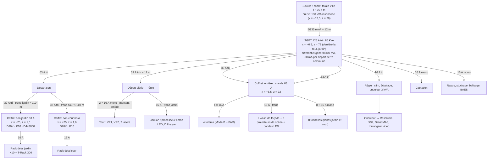
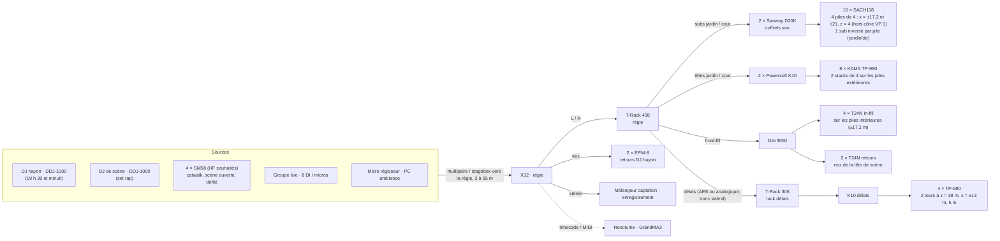
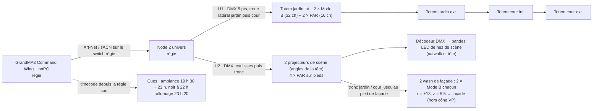
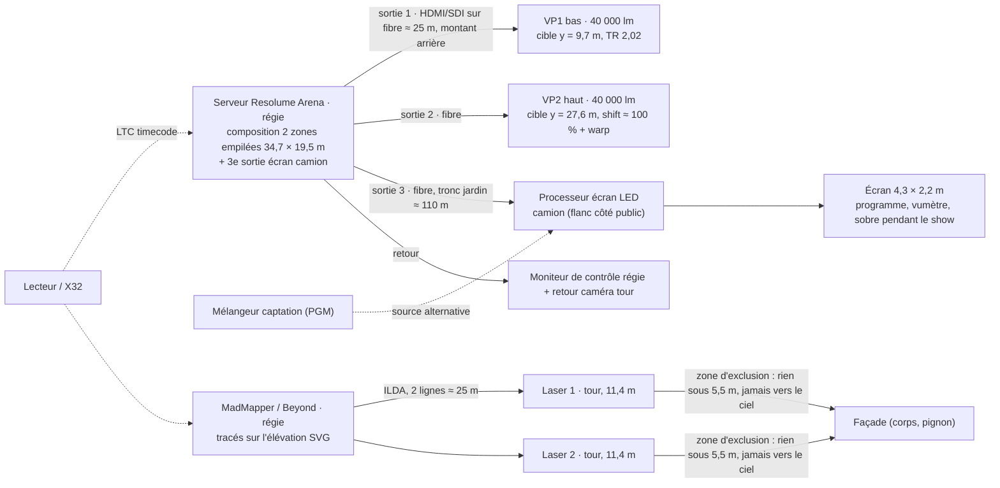
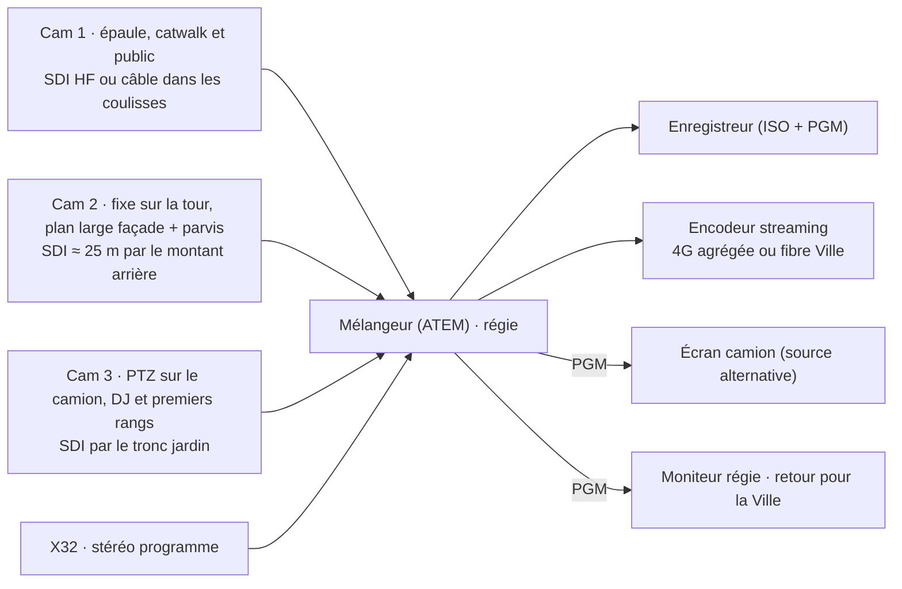

# Synoptiques et bilan électrique — parvis de la basilique Saint-Denis

Version du 2 novembre 2026, cohérente avec la démo `outils/demo-evenement.html` (version 5 :
catwalk, camion, stands sur les flancs, tour Layher) et le registre `evenement/registre.json`
(entrée `2026-11-02_book-noname`). Tout est **à confirmer** par les devis et les fiches
techniques : les puissances des amplis sont des appels moyens estimés à 1/8 de la puissance
nominale (programme musical), les enceintes sont passives.

## 0. Résumé

| Poste | Appelé | Départ TGBT | Où |
|---|---|---|---|
| Son | 14 kW | 63 A tri | coffrets son jardin et cour, pieds de façade |
| Lumière | 4,5 kW | 32 A tri | coffret lumière · stands, derrière la tour côté cour |
| Vidéo (VP, serveur, écran camion, lasers) | 12,5 kW | 32 A tri | régie, tour, camion |
| Captation | 1,5 kW | 16 A mono | régie |
| Régie (clim, éclairage, onduleur) | 3 kW | 16 A tri | régie |
| Stands (8 × 2 kW) | 16 kW | 63 A tri | coffret lumière · stands |
| Repos, stockage, balisage, secours | 2 kW | 16 A mono | derrière la tour |
| **Total appelé** | **53,5 kW** | **TGBT 125 A tri (86 kVA)** | derrière la tour côté jardin |

Source : **coffret forain de la Ville** s'il délivre 125 A tri, sinon **groupe électrogène
100 kVA insonorisé** (80 kW, charge prévue 67 %, ≈ 16 L/h, 160 L pour la soirée + réserve),
placé derrière les stands côté jardin, hors vue, avec une zone d'exclusion de 2 m.

Jauges (calcul de la démo, grille au mètre) :

| Espace | Surface | Jauge |
|---|---|---|
| Zone public nette (52 × 54 m moins podium + marges et îlots de délai) | 2 712 m² | **5 424** à 2 pers/m² · 8 136 maxi à 3 pers/m² (ERP PA debout) |
| Flancs devant les stands (files, circulation) | 161 m² | 161 à 1 pers/m² |
| Plateau : tête 6 × 4 + catwalk 2,4 × 12 | 52,8 m² | 35 en défilé (1,5 m²/pers), structure 500 kg/m² |
| Coulisses (entre podium et régie) | 30 m² | 30 artistes et régisseurs |
| Repos équipe | 18 m² | 9 assis |
| Hayon (plateau DJ) | 3,5 m² | **2 personnes** (charge hayon ≈ 750 kg, à lire sur le véhicule) |

La jauge de référence à déclarer est celle à 2 pers/m² ; la Ville et la préfecture
peuvent imposer moins. Les couloirs latéraux (x = ±26 à ±30 m) restent libres sur 4 m pour
les secours.

## 1. Bilan de puissance détaillé

### 1.1 Son — 14 kW

| Équipement | Qté | Appel unitaire | Total | Note |
|---|---|---|---|---|
| Sanway D20K (4 × 5 000 W) — subs | 2 | 3 000 W | 6 000 W | 16 SACH118, 2 par canal (4 Ω) |
| Powersoft K10 — têtes TP-980 (2 mains + 1 délais) | 3 | 1 800 W | 5 400 W | 2 têtes par canal |
| D4×3000 — in-fill et retours | 1 | 1 500 W | 1 500 W | 4 × T24N in-fill + 2 × T24N retours |
| X32, T-Rack 408 + 306, 2 × DDJ-1000, EPM-8, périphériques | — | — | 400 W | régie et rack délais |
| Marge câblage / cos φ | — | — | 700 W | |

Crête réelle très supérieure à la moyenne : **un départ 32 A tri par coffret son**
(jardin et cour), sur un départ 63 A tri du TGBT. Les racks d'amplis sont aux pieds de
façade, à côté des piles, pour garder les câbles HP courts (< 15 m) ; les délais ont leur
rack au pied de chaque tour (K10 + T-Rack 306), alimentés par le tronc latéral.

### 1.2 Lumière — 4,5 kW

| Équipement | Qté | Unitaire | Total |
|---|---|---|---|
| Starway Mode B 150 W (4 totems × 2 + 2 wash × 2) | 12 | 150 W | 1 800 W |
| PAR 64 LED (4 totems × 2 + 4 scène) | 12 | 100 W | 1 200 W |
| Projecteurs de scène sur pieds (angles de la tête) | 2 | 300 W | 600 W |
| Bandes LED de nez de scène + alimentations + décodeur DMX | — | — | 500 W |
| GrandMA3 Command Wing + PC + nodes Art-Net | — | — | 200 W |
| Éclairage de service et de secours (coulisses, escaliers, repos) | — | — | 200 W |

### 1.3 Vidéo — 12,5 kW

| Équipement | Qté | Unitaire | Total | Note |
|---|---|---|---|---|
| Vidéoprojecteur classe 40 000 lm (laser) | 2 | 4 200 W | 8 400 W | sur la tour, 2 × 16 A mono dédiés tirés du départ vidéo |
| Serveur Resolume + moniteurs + switch fibre | 1 | 800 W | 800 W | régie |
| Écran LED camion 4,3 × 2,2 m (≈ 9,5 m²) | 1 | 2 500 W moyen / 5 700 W crête | 2 500 W | processeur dans le camion, alimenté par le tronc jardin |
| Laser RGB 10 W | 2 | 300 W | 600 W | sur la tour |
| Réserve | — | — | 200 W | |

Mapping : 2 × 40 000 lm sur 2 zones empilées de 34,7 × 19,5 m → **41 lux** sur la façade ;
4 × 40 000 lm → 83 lux (voir `mapping-basilique-saint-denis/CALCULS-MAPPING.md`). Le camion
est dans le bas du cône du VP 1 : **ombre de 0 à 2,5 m de haut sur 9,6 m de large** au pied
de la façade — le contenu doit prévoir cette zone noire (ou on y mappe le flanc du camion).

### 1.4 Captation — 1,5 kW

3 caméras (épaule catwalk, fixe sur la tour en plan large, PTZ sur le camion), mélangeur en
régie, enregistreur, encodeur de streaming (4G agrégée ou fibre Ville), moniteurs.

### 1.5 Régie, stands, repos — 21 kW

Régie : clim 2 kW, éclairage, onduleur 3 kVA pour le serveur Resolume, la X32 et la
GrandMA (autonomie 15 min, le temps de basculer sur le groupe). Stands : 8 × 16 A mono
(frigos, machines à café, plaques) soit 2 kW chacun en moyenne, 63 A tri au total.
Repos / stockage / balisage / BAES : 2 kW.

## 2. Synoptique électrique

Règles : un seul point de terre, pas de prolongateur sur enrouleur en charge, passages de
câbles roulables dans les couloirs pompiers, PV de vérification de l'installation
temporaire (Consuel ou organisme agréé selon la demande de la commission), arrêt d'urgence
général en régie et au TGBT.

## 3. Synoptique son

Points de calage : les 4 piles forment 2 groupes L/R (3,8 m entre piles d'un même côté,
34 m entre jardin et cour) : allées de puissance au centre inévitables ; on cale chaque
groupe (délai, polarité) sur la position de régie et on contrôle au sonomètre sur l'axe et
à ±10 m. Les piles sont **hors du cône du VP 1** : une pile à ±8,5 m aurait ombré les
portails latéraux sur 3 m de haut (contrôle du visualiseur). Les délais à 38 m sont calés sur
les mains (≈ 100 ms) avec un bruit rose et un analyseur. Niveaux : **102 dB(A) et 118 dB(C)
sur 15 min** (décret 2017-1244), afficheur en régie, enregistrement des niveaux, information
des riverains et horaires de la Ville.

## 4. Synoptique lumière

Patch : U1 = 4 × (2 × 16 + 2 × 8) = 192 canaux ; U2 = scène + wash + décodeur LED ≈ 120
canaux (mode des PAR et des projecteurs de scène à relever — skill `patch-lumiere`). Les
wash de façade restent **hors du cône des VP** et ne visent aucune fenêtre riveraine ; ils
s'éteignent à 22 h avec l'éclairage public.

## 5. Synoptique vidéo (mapping, écran camion, lasers)

Masques Resolume : corps de façade jusqu'au pignon (tour exclue, traitée en wash), zone
noire pour l'ombre du camion (0 → 2,5 m). Le VP 2 travaille en shift maximal : prévoir
l'inclinaison de la machine + warp. La régie surélevée de 1,2 m voit la façade par-dessus le
podium ; si la vitre reste trop basse, le retour caméra de la tour sert de contrôle.

## 6. Synoptique captation

Droit à l'image : annonce à l'entrée et sur l'écran camion, pas de gros plan sur les mineurs
sans accord, et la règle de la skill `flux-evenement` reste : aucune identification de
personnes à partir des visages dans le registre.

## 7. Passages de câbles

≈ 280 m de passages au sol (calcul de la démo) :

| Tronçon | Longueur | Type |
|---|---|---|
| Troncs jardin et cour : régie → derrière la zone public (z ≈ 63 m) → couloirs latéraux (x = ±27,5 m) → ligne de façade (z = 1,6 m) | 2 × ≈ 110 m | 3 voies ; **5 voies roulables** sur les ≈ 2 × 62 m des couloirs pompiers |
| Traversées du public vers les tours de délai (z = 38 m) | 2 × 14,5 m | 2 voies piétons jaune / noir, un agent par îlot |
| Régie → podium (coulisses, hors public) | 3 m | 2 voies |
| TGBT → régie, TGBT → tour, GE → TGBT | ≈ 32 m | 3 voies, hors public |

Contenu des troncs : puissance (son 32 A tri par côté, lumière, camion), audio (AES ou
analogique vers les délais et les racks), DMX, fibre vidéo (écran camion), SDI (cam 3).
Les câbles HP restent courts (racks aux pieds de façade).

## 8. Tour Layher Allround — nomenclature

Géométrie : 3 travées de 3,07 m × 1 travée de 3,07 m, embase à 0,30 m, 5 niveaux de 2,00 m,
plancher à 10,30 m, garde-corps à 0,50 et 1,00 m, plinthes, toit bâché à 12,90 m, VP à
10,80 m (lentille), lasers à 11,40 m sur trépieds.

| Pièce | Réf. Layher | Qté | Statut de la référence |
|---|---|---|---|
| Montant Allround 2,00 m | 2603.200 | 44 | famille 2603.xxx citée (DOC0345) ; longueur à confirmer |
| Montant Allround 1,00 m | 2603.100 | 8 | idem |
| Embase (collier de départ) | 2602.000 | 8 | citée (DOC0345) |
| Vérin de pied 0,60 m | 4001.060 | 8 | citée (DOC0345) |
| Moise O 3,07 m | 2607.307 | 70 | citée (brochure Allround NL) ; LW : 2601.307 |
| Moise U 3,07 m (support planchers) | 2611.307 | 6 | à confirmer |
| Diagonale 3,07 × 2,00 m | 2620.307 | 40 | famille 2620.xxx citée (DOC0345) |
| Plancher acier LW 3,07 × 0,32 m | 3883.307 | 27 | série 3883 citée (FIS 64, 19,3 kg) |
| Plancher acier 3,07 × 0,19 m | — | 3 | à confirmer |
| Plancher à trappe + échelle alu 3,07 × 0,61 m | — | 5 | à confirmer |
| Plinthe 3,07 m | — | 8 | Allround à confirmer (Blitz : 1757.307) |
| Lest béton ≈ 1 t, sanglé | hors Layher | 8 | note de calcul au vent |
| Bâche de toit + filet + fixations | hors Layher | 1 | démontage au-delà de 50 km/h |

Sources consultées : notice Layher étaiement Allround DOC0345 (socles 4001.060, embases
2602.000, montants 2603.xxx, diagonales 2620.xxx) —
<https://www.layher.nl/-/media/layher/documentatie/06-ondersteuning/french/fr-traditionele-kopspindel-badding-ondersteuningen-ar-doc0345-0621.pdf> ;
fiche Layher France FIS 64 plancher acier LW (série 3883) —
<https://www.layher.fr/permadoc/FIS_64_Plancher_acier_LW.pdf> ; brochure Layher Allround
(moise 2607.307) — <https://steigerhuur.nl/wp-content/uploads/2017/01/brochure_schoorsteensteigers.pdf> ;
fiche garde-corps Layher (moise LW 2601/xxx, plinthe 1757/xxx) —
<https://www.layher.nl/-/media/layher/documentatie/04-systeemvrij-accessoires/french/fr-leuningklem-dakrandbeveiliging-doc0016.pdf> ;
catalogue « Layher Éléments » (juin 2021) à consulter pour trancher —
<https://www.layher.fr/wp-content/uploads/2024/05/layher_elements_juin_2021.pdf>.
Les sites Layher n'étaient pas joignables depuis l'environnement de travail : les
références non confirmées suivent la numérotation Layher (famille.longueur en cm) et doivent
être validées par le loueur avant commande.

## 9. Ce qui reste à faire valider

- commission de sécurité : catwalk sans garde-corps (face jouée), jauge, voies pompiers,
  tours de délai dans le public, camion moteur coupé devant un monument ;
- CMN / DRAC : projection, aucune fixation, emprise du chantier de la tour nord ;
- DGAC : déclaration lasers, cibles sur façade seule, opérateur certifié ;
- monteur Layher : note de calcul au vent, lestage, PV de montage ;
- prestataire son : prédiction acoustique (nombre de têtes, calage des 4 piles), niveaux ;
- Ville : extinction de l'éclairage public 22 h → 23 h 20, puissance du coffret forain,
  horaires, information des riverains.
