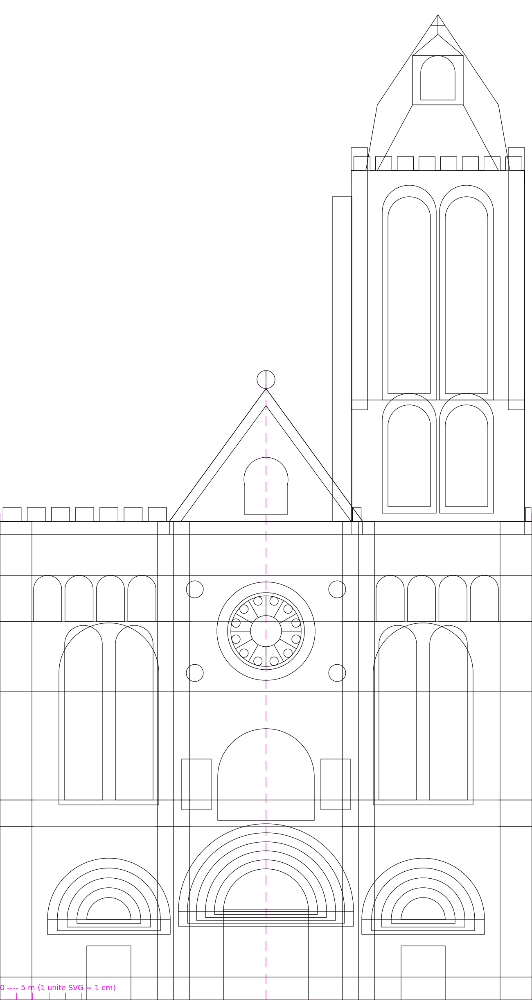

# Mapping façade — Basilique-cathédrale de Saint-Denis

Kit de préparation d'un mapping vidéo + laser sur la **façade occidentale** :
élévation vectorielle métrique, masque, tracé laser, et calculs de dimensionnement.



## Contenu

| Fichier | Quoi |
|---|---|
| **[CALCULS-MAPPING.md](CALCULS-MAPPING.md)** | **Le dossier technique.** Calage, cotes, optique, puissance, Resolume, laser, autorisations. À lire en premier. |
| `facade-saint-denis_ELEVATION.svg` | Élévation complète, 12 calques nommés — fichier de travail |
| `facade-saint-denis_MASQUE.svg` | Silhouette pleine → masque alpha Resolume / AE |
| `facade-saint-denis_LASER.svg` | Tracé simplifié trait seul → MadMapper / MadLaser |
| `calculateur-mapping.html` | Calculateur interactif : lux, rapport de projection, pavage, résolution de comp |
| `generer_facade_svg.py` | Générateur des 3 SVG — toutes les cotes en tête de fichier |
| `apercu-*.png` | Rendus de contrôle |

## Convention SVG

**1 unité SVG = 1 cm réel.** viewBox `0 0 3250 6100` = 32,50 m × 61,00 m.
Sol sur le bord inférieur, axe de symétrie à `x = 1625`.

## Chiffres clés

| | |
|---|---|
| Largeur du massif occidental | 32,50 m |
| Hauteur au parapet / au pignon | 29,20 m / 37,30 m |
| Hauteur de la tour sud | 58,00 m (60,10 m à la croix) |
| Surface de pierre, hors tour | 997 m² |
| Distance de projection relevée | 122,88 m → **TR 3,54 : 1** |
| Pavage retenu | 2 zones empilées, blend 1,70 m, 1 296 m² éclairés |
| Composition Resolume | 3840 × 4136 px — **111 px/m** |
| **Puissance pour 80 lux** | **~148 000 lm installés (5 × 30 k)** |

## Deux avertissements

1. **Chantier de la tour nord en cours** (mars 2025 → ~2030, échafaudage > 90 m sur
   le flanc nord). À vérifier auprès du CMN **avant** tout chiffrage.
2. L'élévation est un **relevé photogrammétrique approché (± 3 à 5 %)**, pas un
   relevé de géomètre. Voir § 1.4 du dossier pour le protocole de recalage sur site.

## Régénérer

```bash
python3 generer_facade_svg.py
```
